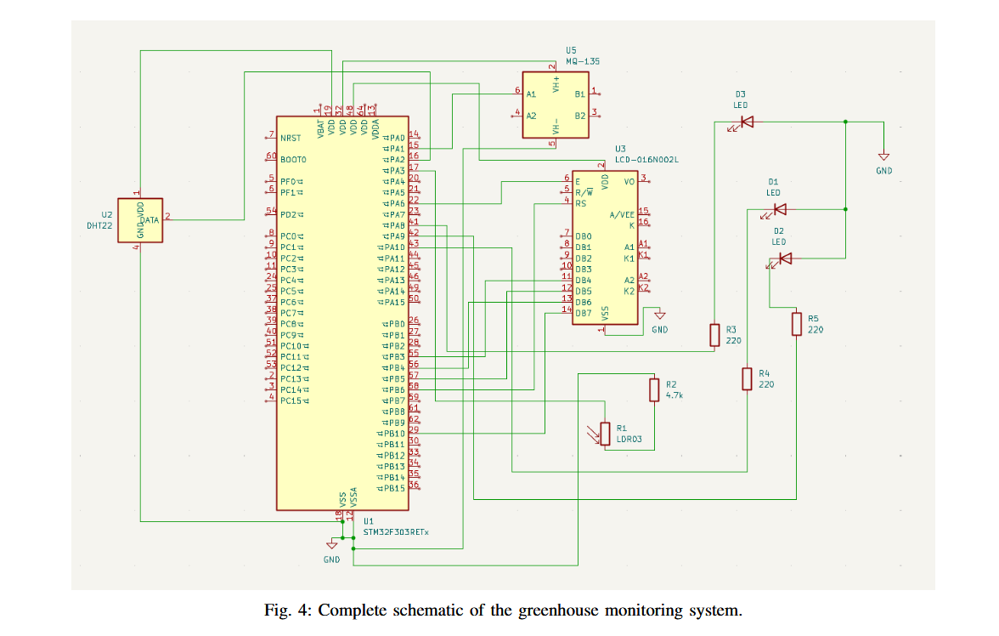
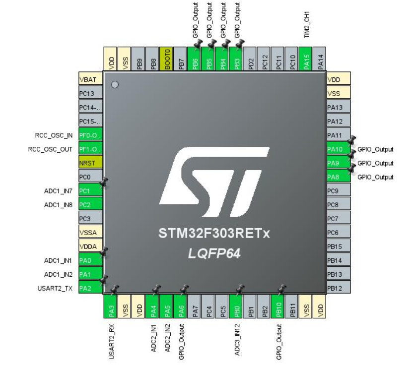
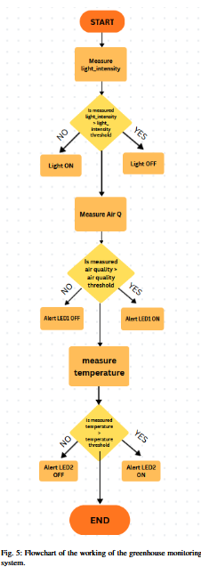
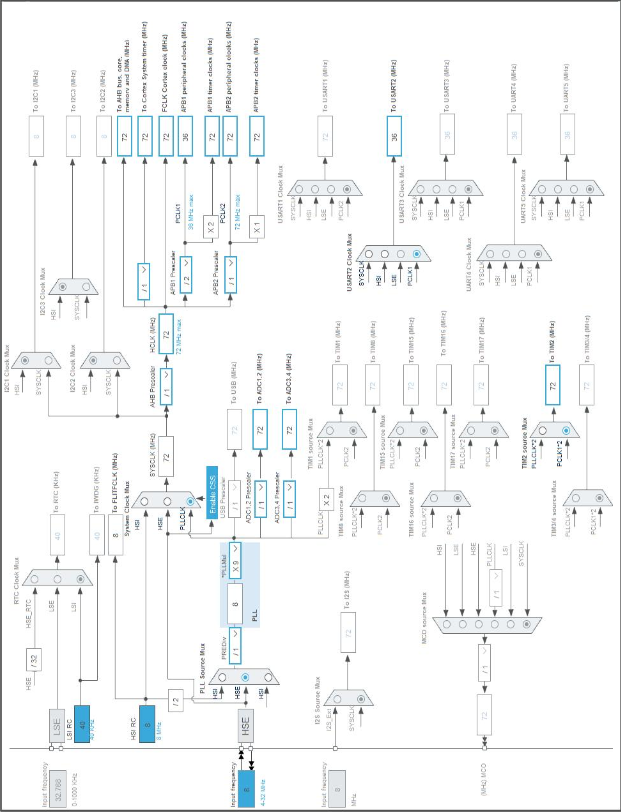
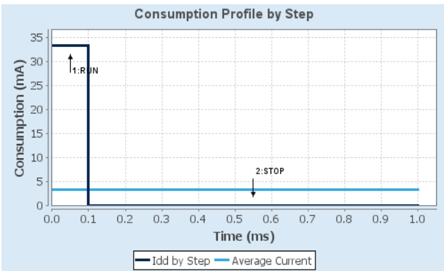

# Smart Greenhouse System

Firmware for an **STM32F303RE** smart greenhouse monitor and controller, configured with STM32CubeMX/CubeIDE.

## What it does

- Reads **air quality** (MQ-135), **temperature/humidity** (DHT22), and **light** (LDR).
- Applies configurable thresholds and switches GPIO outputs for air quality, temperature, and light control.
- Cycles live readings on a 16x2 LCD and writes diagnostics to UART2 at 115200 baud.

Thresholds are defined near the top of [`ProjectFiles/main.c`](ProjectFiles/main.c): air quality, 29 C temperature, and light level 1200.

## Hardware

## Control flow & configuration

- MCU configuration: `ProjectFiles/SmartGreenhouseSystem.ioc` 
- Application code: `ProjectFiles/main.c`
- 16x2 LCD driver: `ProjectFiles/ECUAL/LCD16X2/`
